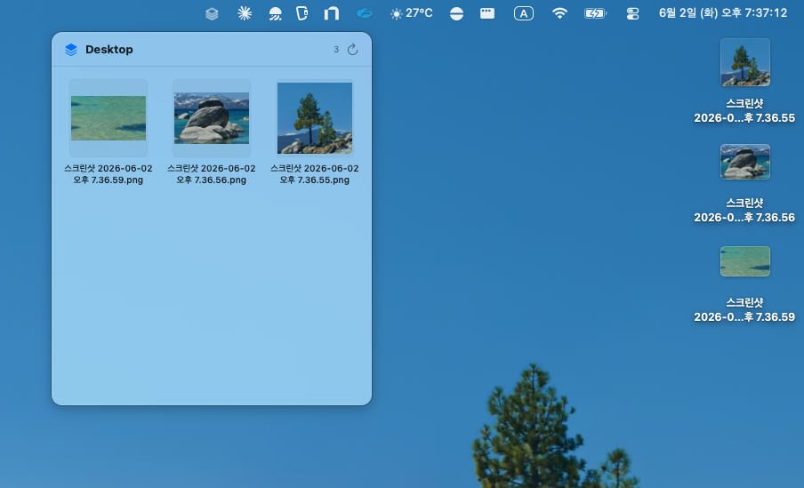
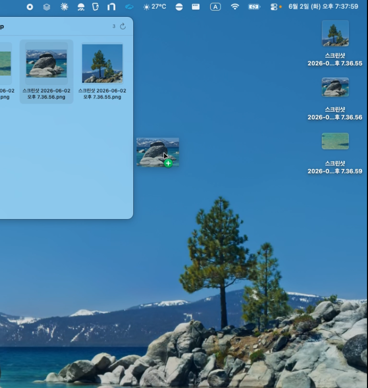

# Quick Desktop

<p align="center">
  
</p>

<p align="center">
  맥 메뉴바에서 데스크탑 폴더의 파일을 빠르게 꺼내 쓰는 작은 도구.
</p>

<p align="center">
  <a href="https://github.com/Wayne-Kim/quick-desktop/releases/latest">
    
  </a>
  
  
</p>

---

## 무엇을 해결하나요

화면에 여러 창을 동시에 띄워 쓰다 보면, 스크린샷을 찍어도 그 파일이 데스크탑 위에 깔려서 안 보이는 경우가 많습니다. 마우스로 일일이 창을 치우고 데스크탑까지 내려가서 파일을 집어 올리는 일이 번거롭죠.

**Quick Desktop**은 메뉴바 아이콘 한 번으로 데스크탑 파일을 썸네일 그리드로 보여주고, 거기서 바로 다른 앱(브라우저의 GitHub PR 첨부창, Slack 입력창, Finder 등)으로 드래그할 수 있게 해 줍니다.



## 주요 기능

- 🚀 **메뉴바 즉시 호출** — 단축키나 화면 전환 없이 상태바 아이콘 클릭 한 번
- 📁 **여러 폴더 동시 추적** - 데스크탑과 다운로드처럼 폴더 여러 개를 한 목록에서 함께 보기
- 🖼️ **썸네일 그리드** — 이미지·동영상·PDF는 실시간 미리보기
- 📥 **외부 앱으로 드래그** — GitHub PR 첨부창, Slack, Finder, 메일 등에 바로 드롭
- 🔄 **실시간 갱신** — 새 스크린샷을 찍으면 1초 안에 자동으로 맨 위에 등장
- ⚡ **정렬 선택** - 수정시각·이름·크기·종류 중에서 고르고 오름차순/내림차순 전환
- 🔀 **보기 전환** - 큰 아이콘·작은 아이콘·목록, 폴더별로 나눠 보기와 한 목록으로 합쳐 보기
- 👀 **Quick Look·열기·휴지통** — 우클릭 컨텍스트 메뉴로 모든 기본 동작
- 🔁 **자동 업데이트** — Sparkle 프레임워크로 새 버전 자동 알림
- 🪶 **가벼움** — 1.6 MB DMG, 사용 중 메모리 < 30 MB

## 설치

[최신 릴리즈 페이지](https://github.com/Wayne-Kim/quick-desktop/releases/latest)에서 `quick-desktop-x.y.z.dmg`를 받아:

1. DMG를 더블클릭해서 마운트
2. `Quick Desktop.app`을 `Applications` 폴더로 드래그
3. `Applications`에서 `Quick Desktop`을 실행
4. 최초 실행 시 **데스크탑 접근 허용** 다이얼로그가 뜨면 **허용**

> 앱은 Apple에 공증(notarized)되어 있어 Gatekeeper 경고 없이 바로 실행됩니다.

### 시작 시 자동 실행

상태바 아이콘 우클릭 → **Launch at Login** 체크. 다음 로그인부터 자동 등장합니다.

## 사용법

| 동작 | 결과 |
|---|---|
| 상태바 아이콘 좌클릭 | 패널 열기 / 닫기 |
| 셀을 다른 앱으로 드래그 | 파일을 그 앱에 드롭 (GitHub PR, Slack, Finder…) |
| 셀 더블클릭 | 기본 앱으로 열기 |
| 셀 우클릭 | Open · Reveal in Finder · Quick Look · Copy · Move to Trash |
| 패널 헤더의 폴더 아이콘 클릭 | 추적할 폴더 선택 (기본값: 데스크탑) |
| 패널 밖 클릭 또는 ESC | 패널 닫기 |
| 상태바 아이콘 우클릭 | Open Folder in Finder · Choose Folder to Track · Reset to Desktop · Launch at Login · Check for Updates · Quit |



## 시스템 요구 사항

- macOS 13 Ventura 이상
- Apple Silicon / Intel 모두 지원

## 개발 환경 설정

처음 클론한 뒤 빌드까지:

```bash
# 1. 도구 설치
brew install xcodegen gh

# 2. 환경 변수 파일 작성
cp .env.example .env
# .env 를 편집해서 본인 값으로 채우세요 — Team ID, Bundle ID, GitHub token,
# Sparkle public key 등이 필요합니다. 각 항목 설명은 .env.example 참고.

# 3. Sparkle 바이너리 도구 받기 (sign_update, generate_keys)
mkdir -p tools/sparkle && curl -L \
  https://github.com/sparkle-project/Sparkle/releases/download/2.9.2/Sparkle-2.9.2.tar.xz \
  | tar -xJ -C tools/sparkle

# 4. Sparkle 키페어 생성 (한 번만)
./tools/sparkle/bin/generate_keys
# 출력에 나오는 public key를 .env 의 SPARKLE_PUBLIC_KEY 에 넣으세요.

# 5. 프로젝트 생성 & 빌드
./bin/gen-project.sh         # project.yml + .xcodeproj 생성
open quick-desktop.xcodeproj # Xcode에서 열기
```

### 릴리즈

```bash
./release.sh 0.2.0
```

archive → 서명 → DMG → Apple 공증 → 스테이플 → Sparkle 서명 → appcast.xml 생성 → GitHub Release 업로드까지 한 번에 진행됩니다. 첫 실행 전에 keychain 자격을 한 번 저장해야 합니다:

```bash
xcrun notarytool store-credentials "quickdesktop-notary" \
  --apple-id "<your apple id>" \
  --team-id "<your team id>" \
  --password "<app-specific password>"
```

## 아키텍처 간략

```
AppDelegate
  └── StatusBarController          # NSStatusItem, 좌클릭 토글 / 우클릭 메뉴
       └── PanelController         # nonactivating NSPanel + NSVisualEffectView
            └── ContentView        # LazyVGrid
                 └── FileGridItem  # 썸네일·드래그·컨텍스트 메뉴

DesktopStore (ObservableObject)
  └── DesktopFolderObserver        # DispatchSource on ~/Desktop fd
ThumbnailCache                     # QLThumbnailGenerator + NSCache
UpdaterController                  # Sparkle SPUStandardUpdaterController
```

자세한 결정 배경은 [PLAN.md](PLAN.md) 참고.

## 라이선스

MIT
